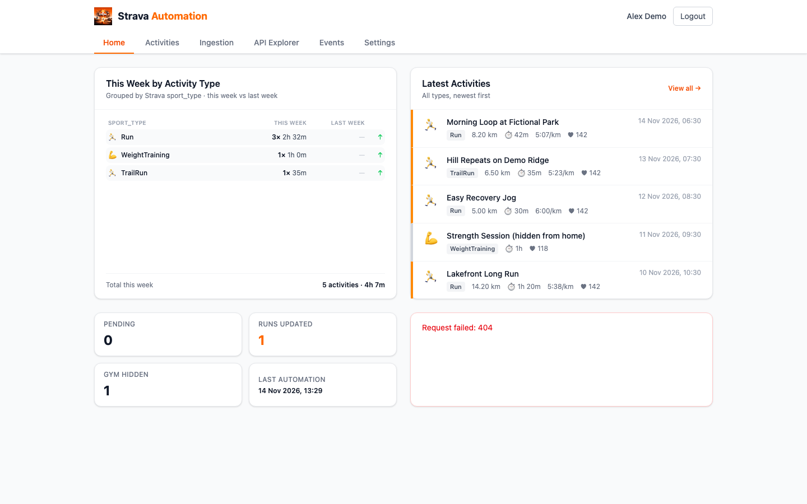
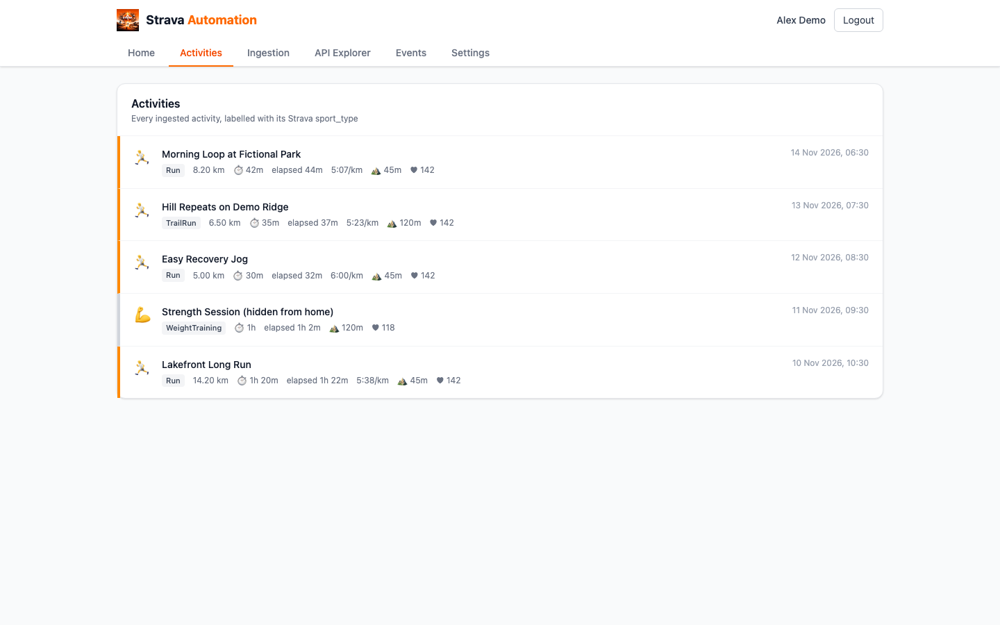
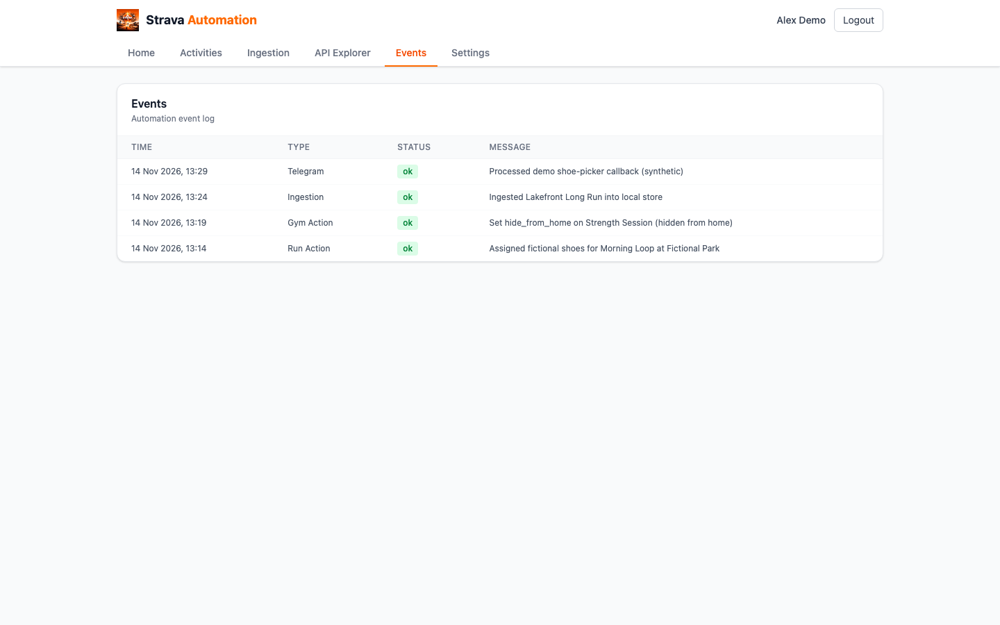
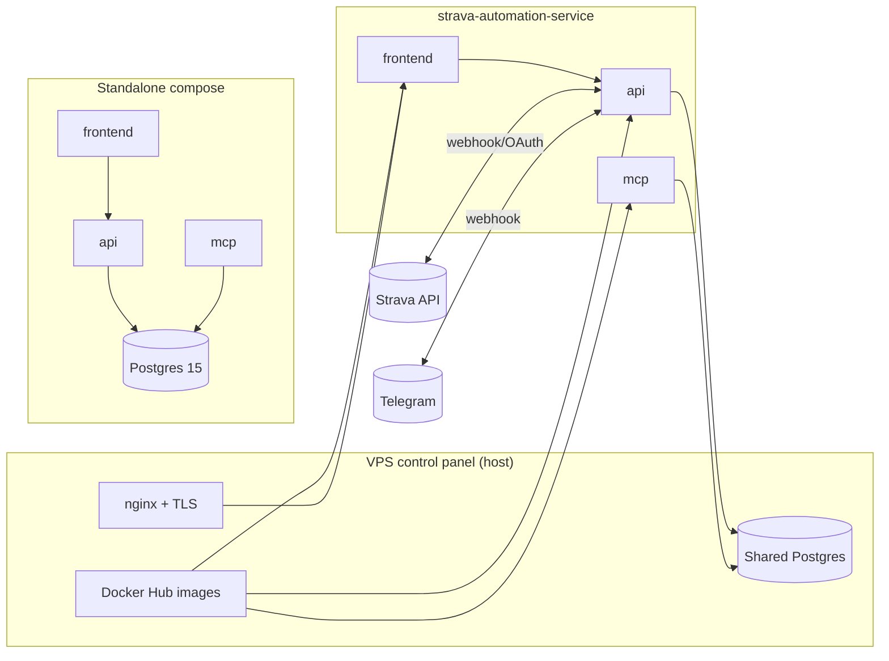

# Strava Automation Service

Single-user automation that ties Strava activities to Telegram workflows: assign running shoes on new runs, hide gym workouts from your Strava home feed, ingest activities for search and MCP tools, and operate everything from a small React dashboard.



## Overview

The service listens for Strava and Telegram webhooks, applies your rules in-process on a FastAPI backend, and stores operational history in PostgreSQL. A React frontend proxies `/api` to the backend for same-origin auth cookies. A separate MCP server (same backend image) exposes read-only activity tools to compatible clients.

This application is **single-user**: one connected Strava athlete and one allowed Telegram user. Strava OAuth and Telegram webhooks require a **public HTTPS base URL** that `docker-compose.standalone.yml` does not provide by itself—you must supply `PUBLIC_BASE_URL` (and credentials) when registering webhooks, or leave it unset to skip registration during local runs.

## Features

- **Run shoe picker** — Telegram prompt on every new run so you can change shoes even when a default is set.
- **Gym hide** — Sets `hide_from_home=true` on weight training and generic workouts.
- **Activity store** — Local copy of activities, laps, splits, and ingestion jobs for the dashboard and external API.
- **Backfill** — Queue historical ingestion without blocking webhook handling.
- **MCP tools** — API-key gated Model Context Protocol server for activity queries.
- **Dashboard** — Home stats, stored activities, ingestion controls, event log, and settings.

## Screenshots

| Home | Activities | Events |
|------|------------|--------|
|  |  |  |

## Architecture



**Control panel path:** `docker-compose.yml` runs `api`, `frontend`, and `mcp` from prebuilt images on loopback ports, attached to external `postgres-net` (no Postgres service in this file). The panel writes `.env`, pulls tags, runs migrations, and checks `/api/health`.

**Standalone path:** `docker-compose.standalone.yml` bundles Postgres 15, builds production images locally, and publishes the frontend on all interfaces; API and MCP stay on loopback.

**Development path:** `docker-compose.dev.yml` bundles Postgres with hot reload on `api` and Vite on `frontend`.

## Technology stack

| Layer | Choice |
|-------|--------|
| API | FastAPI, SQLAlchemy, Alembic |
| Frontend | React, TypeScript, Vite, Tailwind CSS |
| Database | PostgreSQL 15 |
| Auth | Strava OAuth + HTTP-only JWT cookie |
| Integrations | Strava REST + webhooks, Telegram Bot API |
| MCP | FastMCP (`mcp` service) |
| Packaging | Docker Compose |

## Getting started

1. `cp .env.example .env` and set database credentials, Strava/Telegram placeholders, and `APP_SECRET_KEY`. For local HTTP, set `COOKIE_SECURE=false`.
2. Start development Compose:

```sh
docker compose -f docker-compose.dev.yml up --build
```

3. Migrate:

```sh
docker compose -f docker-compose.dev.yml run --rm --no-deps api bash /app/run_migrations.sh
```

4. Optional demo data:

```sh
docker compose -f docker-compose.dev.yml run --rm --no-deps api python /app/scripts/seed_db.py
```

5. Open `http://localhost:${FRONTEND_PORT:-3000}`.

**Local-only sign-in:** After seeding, click **Continue with Strava** on the login screen. The app uses fast login (`POST /api/auth/login`) when a connected user with a refresh token exists in the database—no live Strava call.

## Configuration

See `.env.example` for all variables. Important groups:

- **Database** — `POSTGRES_*`; use `POSTGRES_HOST=postgres` for dev and standalone Compose.
- **Strava / Telegram** — OAuth and webhook secrets; `PUBLIC_BASE_URL` for production webhook registration.
- **Auth** — `APP_SECRET_KEY`, optional `JWT_SECRET_KEY`, `COOKIE_SECURE`.
- **Compose** — `BACKEND_PORT`, `FRONTEND_PORT`, `MCP_PORT`; image tags are for panel deploys only.

## Deployment

- **Local development** — `docker-compose.dev.yml` (see [Getting started](#getting-started)).
- **Standalone** — Self-hosted stack with bundled Postgres: `docker-compose.standalone.yml`.
- **This VPS** — Image-mode deploy via the control panel and root `docker-compose.yml`.

Details: [docs/deployment.md](docs/deployment.md).

## API

- **Health:** `GET /api/health`
- **Interactive docs:** `GET /docs` on the API port (e.g. `http://127.0.0.1:8000/docs` in standalone).
- **UI (JWT cookie):** `/api/ui/*` — status, activities, events, ingestion, settings.
- **Auth:** `/api/auth/strava/*`, `/api/auth/login`, `/api/auth/logout`
- **Webhooks:** `/api/strava/webhook`, `/api/telegram/activityadmin/webhook/{secret}`
- **External read API:** `/api/external/*` (API key)
- **MCP:** separate `mcp` service on `MCP_PORT`

## Development and tests

**Backend (host, with deps installed):**

```sh
cd backend && uv sync --extra dev && uv run pytest
```

**Frontend:**

```sh
cd frontend && npm ci && npm test && npm run lint && npm run typecheck
```

**Screenshots** (standalone stack, after migrate + seed):

```sh
docker compose -f docker-compose.standalone.yml up --build -d
docker compose -f docker-compose.standalone.yml run --rm --no-deps api bash /app/run_migrations.sh
docker compose -f docker-compose.standalone.yml run --rm --no-deps api python /app/scripts/seed_db.py
npm install --prefix scripts
npx --prefix scripts playwright install chromium
FRONTEND_URL=http://127.0.0.1:3000 node scripts/capture-screenshots.mjs
docker compose -f docker-compose.standalone.yml down
```

Writes `docs/images/hero.png`, `feature-01.png`, and `feature-02.png` at 1440×900. Not run in CI.