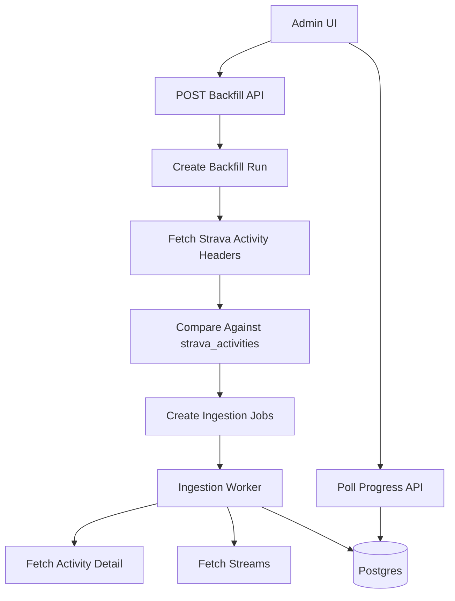

# Strava Backfill And Rate Limiting

This document describes how to backfill historical Strava activities into the proposed ingestion tables while staying within Strava API limits.

Backfill must be additive. It should not change the current Telegram shoe picker, gym hiding flow, existing dashboard behavior, or current Strava webhook responses.

## Goals

- Let the admin UI request ingestion for a date range.
- Discover activities that are missing from local Postgres.
- Queue only missing or explicitly requested activities.
- Respect Strava rate limits.
- Report progress clearly in the UI.
- Make failed items retryable without restarting the whole backfill.

## API Shape

Recommended endpoints under the existing authenticated UI API namespace:

```text
POST /api/ui/backfill
GET  /api/ui/backfill/{backfill_run_id}
GET  /api/ui/backfill/{backfill_run_id}/jobs
POST /api/ui/backfill/{backfill_run_id}/retry-failed
POST /api/ui/backfill/{backfill_run_id}/cancel
```

Example request:

```json
{
  "start_date": "2024-01-01",
  "end_date": "2024-12-31",
  "force_refresh": false
}
```

`force_refresh` should default to `false`. When false, the backend only queues activities missing from `strava_activities` or activities that are marked failed/incomplete. When true, it queues all discovered activities in the range.

## Backfill Flow



Detailed steps:

1. Validate the authenticated user and date range.
2. Create a `strava_backfill_runs` row with status `created`.
3. Mark the run `discovering`.
4. Use Strava activity list pagination to fetch activity headers for the requested window.
5. Query `strava_activities` for activity IDs already stored locally.
6. Identify missing IDs, or all IDs if `force_refresh` is true.
7. Create one `strava_ingestion_jobs` row per selected activity.
8. Mark the run `queued` or `running`.
9. Process jobs with rate-limit-aware workers.
10. Update counters as jobs finish.

## Activity Discovery

Use Strava's athlete activities endpoint for discovery:

```text
GET /api/v3/athlete/activities?after={epoch}&before={epoch}&per_page=200&page={page}
```

Add a new method to `StravaService` instead of changing current callers:

```python
def get_athlete_activities_between(
    self,
    db: Session,
    user: User,
    after_epoch: int,
    before_epoch: int,
    max_pages: int | None = None,
) -> list[dict]:
    ...
```

Keep the existing `get_athlete_activities()` and `get_activities_since()` methods compatible with the current UI dashboard.

## Queue Strategy

### Phase 1: In-Process Jobs

Start with the simplest deployment-compatible option:

- API creates `strava_ingestion_jobs` rows.
- A background task processes jobs sequentially or with very low concurrency.
- Job state is stored in Postgres.
- If the process restarts, queued/running jobs can be retried by a manual endpoint.

This matches the current app's FastAPI `BackgroundTasks` style and avoids adding Redis or a new worker dependency before there is evidence it is needed.

### Phase 2: Dedicated Worker

Move to a dedicated worker when backfills are large enough that process restarts or long-running requests become painful.

Options:

- A second Docker service running a simple polling loop against `strava_ingestion_jobs`.
- RQ or Celery if Redis is acceptable.
- A scheduled job model if backfills are rare and can run one at a time.

The worker should still use the same database tables and ingestion service. The API should not need a large rewrite.

## Rate Limits

Strava commonly documents limits around:

- 100 requests per 15 minutes.
- 1,000 requests per day.

The exact limits can vary by application and should be read from response headers when available.

Relevant headers:

```text
X-RateLimit-Limit
X-RateLimit-Usage
```

These values are usually comma-separated short-window and daily counts.

## Conservative Budgeting

Each full activity ingestion typically needs:

- 1 request for detailed activity.
- 1 request for streams.

Backfill discovery also needs list requests:

- 1 request per up to 200 activity headers per page.

A backfill of 150 missing activities is roughly:

- 1 discovery request if all activities fit on one page.
- 150 detail requests.
- 150 stream requests.
- About 301 total requests.

That can exceed a 15-minute limit if processed too quickly, so the worker needs pacing.

## Token Bucket Approach

Recommended initial behavior:

- Track short-window and daily request usage in memory for the running process.
- Also persist recent rate-limit observations in the backfill/job metadata for visibility.
- Before each Strava request, check whether the next request would exceed the configured budget.
- If the budget is exhausted, sleep until the next 15-minute window or pause the job.

Pseudo-code:

```python
class StravaRateLimiter:
    def before_request(self) -> None:
        if self.short_window_remaining <= self.reserve:
            sleep(self.seconds_until_window_reset())
        if self.daily_remaining <= self.daily_reserve:
            raise RateLimitPaused("daily Strava budget exhausted")

    def after_response(self, response: httpx.Response) -> None:
        self.update_from_headers(response.headers)
```

Recommended reserves:

- Keep at least 10 short-window requests free for normal webhook automation.
- Keep at least 50 daily requests free until there is a better understanding of usage.

This reserve matters because current automation still needs Strava calls for new activities and gear sync.

## Simpler Sleep Strategy

If a full token bucket is too much for the first implementation, use a conservative delay:

- Process one activity every 20 seconds.
- That is about 45 activities per 15 minutes if each activity uses two requests.
- Stop or pause if response headers show the app is close to the limit.

This is slower but easier to reason about and safer for a single-user app.

## Error Handling

Each activity should be its own job. Do not fail the whole backfill because one activity fails.

Recommended behavior:

- Mark transient HTTP failures as `failed` with `last_error`.
- Retry 429 responses only after waiting for the rate window.
- Treat 404 as `skipped` or `deleted`, depending on Strava's response and whether the activity was previously known.
- Keep an attempt count on each job.
- Let the UI retry failed jobs explicitly.

Ingestion errors must not block the current Telegram processing path.

## Progress Reporting

Start with polling. WebSockets can be added later if polling feels poor.

`GET /api/ui/backfill/{id}` should return:

```json
{
  "id": 12,
  "status": "running",
  "start_date": "2024-01-01",
  "end_date": "2024-12-31",
  "requested_count": 150,
  "missing_count": 142,
  "queued_count": 142,
  "succeeded_count": 57,
  "failed_count": 2,
  "skipped_count": 0,
  "last_error": null
}
```

The UI can poll every 2 to 5 seconds while a backfill is active.

Suggested UI states:

- `Discovering activities`
- `Queued 142 missing activities`
- `Ingesting 57 of 142`
- `Paused for Strava rate limit`
- `Completed`
- `Completed with 2 failed activities`

## UI Additions

Backfill UI should be additive to the current dashboard.

Recommended page:

```text
/backfill
```

Recommended controls:

- Start date.
- End date.
- Force refresh checkbox.
- Start backfill button.
- Current run progress.
- Failed job list with retry action.

Do not require changes to existing pages for the current shoe/gym workflows.

## Concurrency

Keep concurrency low at first.

Recommended initial setting:

- 1 active backfill at a time.
- 1 activity ingestion job at a time.
- Webhook-triggered ingestion can share the same queue but should have priority over old backfill jobs.

Priority order:

1. Current Telegram automation, unchanged and independent.
2. Webhook ingestion for new or updated activities.
3. Manual retries.
4. Historical backfill.

## Cancellation

Cancellation should be cooperative.

When a user cancels a backfill:

- Mark the backfill run `cancelled`.
- Leave completed jobs as `succeeded`.
- Mark queued jobs as `skipped` or `cancelled`.
- Allow the currently running job to finish or fail naturally.

Do not delete ingested activities on cancellation.

## Testing Strategy

Run tests inside Docker, consistent with `AGENTS.md`.

Recommended coverage:

- Backfill request validates date ranges.
- Discovery paginates Strava activity headers.
- Missing ID detection avoids duplicate work.
- `force_refresh` queues existing activities.
- Rate limiter pauses before exceeding budget.
- Job failure updates counters without failing the whole run.
- Existing webhook and Telegram behavior remains unchanged.
