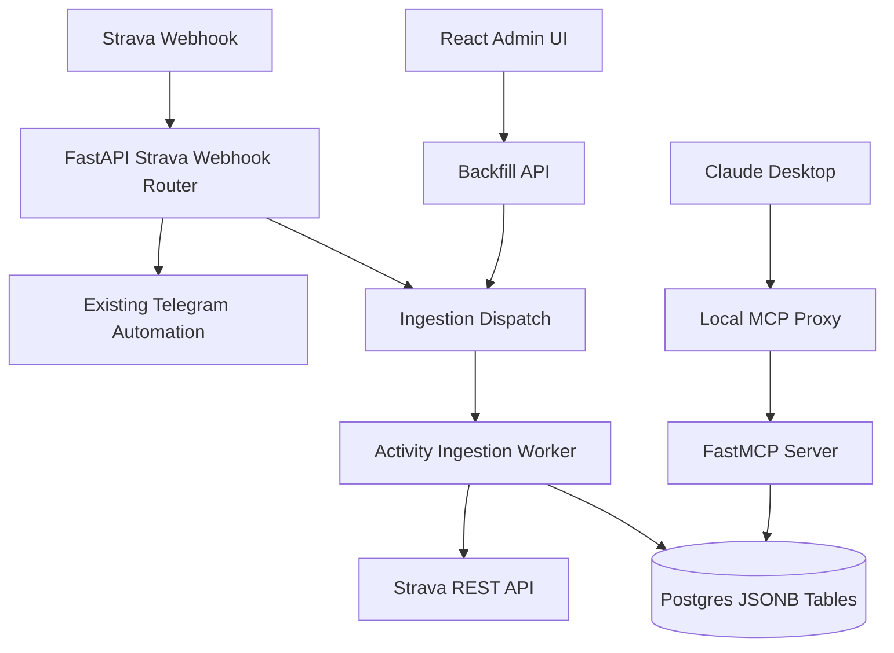

# Strava Ingestion Architecture

This document describes how to add high-fidelity Strava activity ingestion to the existing Strava Automation Service.

The current app must remain unchanged from a user perspective. The existing Telegram shoe picker for runs, gym hiding flow, OAuth behavior, dashboard pages, webhook responses, and event logging should keep working exactly as they do today.

## Current App Shape

The existing system is a single-user FastAPI + React + Postgres app.

- `backend/app/main.py` wires together the API routers.
- `backend/app/routers/strava_webhook.py` receives Strava webhook verification and event callbacks.
- `backend/app/services/webhook_processor.py` handles current activity automation: run shoe selection and gym hiding.
- `backend/app/services/strava_service.py` owns Strava OAuth token refresh and API calls.
- `backend/app/models.py` defines the current tables used by the Telegram/dashboard workflows.
- `frontend/src/App.tsx` and `frontend/src/lib/api.ts` power the current React dashboard.

The ingestion work should add a second Strava activity pipeline alongside the current one. It should not repurpose the current Telegram workflow.

## Target Architecture



The important design choice is fan-out at the webhook boundary:

1. The existing `process_activity()` path continues to handle Telegram automation.
2. A new ingestion path independently fetches and stores complete activity data.
3. Failure in one path does not block the other.

## Webhook Flow

The existing public Strava endpoint is `POST /api/strava/webhook`. It already validates high-level event shape, logs receipt, filters for `object_type == "activity"` and `aspect_type == "create"`, checks `STRAVA_ALLOWED_ATHLETE_ID`, and queues `process_activity()` through FastAPI `BackgroundTasks`.

The ingestion implementation should keep that contract intact:

- Keep `GET /api/strava/webhook` verification behavior unchanged.
- Keep current `POST /api/strava/webhook` response bodies unchanged for existing cases.
- Keep existing event logging for `strava_webhook_received`.
- Keep current create-event behavior for Telegram automation.
- Add ingestion as an independent task dispatch after existing validation.

Recommended future implementation shape:

```python
background_tasks.add_task(process_activity, int(activity_id), owner_id, 0)
background_tasks.add_task(ingest_activity_event, int(activity_id), owner_id, aspect_type)
```

The actual implementation can use a helper function to keep the router small. The key requirement is that `ingest_activity_event()` catches and logs its own failures so ingestion problems do not prevent Telegram messages or gym hiding.

## Supported Strava Events

The current Telegram automation only reacts to `create` events. The ingestion pipeline should support a broader set because the database is intended to mirror Strava activity state.

- `create`: fetch details and streams, then upsert the activity row.
- `update`: refetch details and streams, then update the existing row.
- `delete`: mark the activity as deleted or remove it from queryable results.

Prefer soft deletion for analytics:

- Keep the row for historical audit.
- Set `deleted_at`.
- Set `ingestion_status = "deleted"`.
- Exclude deleted rows from MCP tools by default.

This event expansion should apply only to the new ingestion path. It should not change the current Telegram create-only behavior unless that is explicitly requested later.

## Deep Fetch Sequence

The ingestion worker should use the current `StravaService` token handling and add methods for high-fidelity reads.

Required calls:

1. Ensure the access token is fresh.
2. Fetch detailed activity:

```text
GET /api/v3/activities/{activity_id}?include_all_efforts=true
```

3. Fetch streams:

```text
GET /api/v3/activities/{activity_id}/streams
  ?keys=time,distance,latlng,altitude,velocity_smooth,heartrate,cadence,watts
  &key_by_type=true
```

Recommended new service methods:

- `get_activity_detail(db, activity_id, user, include_all_efforts=True)`
- `get_activity_streams(db, activity_id, user, keys, key_by_type=True)`
- `get_athlete_activities_between(db, user, start, end)`

The existing `get_activity()`, `update_activity()`, `get_athlete_activities()`, and `sync_gear_cache()` methods should remain compatible with the current callers.

## Ingestion Worker Responsibilities

The worker should be idempotent. Reprocessing the same activity should update the same row, not create duplicates.

Recommended worker steps:

1. Load the single configured user and verify Strava OAuth tokens exist.
2. Create or update an ingestion job row for observability.
3. Fetch detailed activity data.
4. Fetch stream data.
5. Extract scalar columns used for filtering and sorting.
6. Calculate lightweight metadata, such as stream sample count and data availability flags.
7. Upsert new ingestion tables in one transaction.
8. Mark the job as complete or failed.

Do not send Telegram messages from this worker. Do not call `update_activity()` from this worker except for future explicitly documented write operations.

## Backwards Compatibility Boundary

The following behavior is protected:

- Runs still trigger the Telegram shoe picker when `run_shoe_enabled` is true.
- Gym and workout activities still get `hide_from_home=true` when `gym_hide_enabled` is true.
- Existing dashboard pages and `/api/ui/*` responses remain compatible.
- Existing tables `users`, `gear`, `pending_activities`, and `event_log` are not renamed or repurposed.
- Existing Strava OAuth scopes should not be reduced.

Before implementation touches shared webhook or Strava service code, add or preserve regression tests for:

- Strava webhook verification.
- Ignored non-activity and non-create behavior for current automation.
- Run activity Telegram processing.
- Gym hiding processing.
- UI auth and settings endpoints.

## Deployment Shape

The first implementation can run ingestion tasks inside the existing FastAPI container using `BackgroundTasks`, matching the current app's simple deployment model.

Move to a dedicated worker only when needed:

- Backfills take longer than a single web process should own.
- Retry durability matters across container restarts.
- Multiple concurrent ingestion jobs need scheduling and rate limiting.

If a worker is introduced, prefer a separate Docker service sharing the same code image and Postgres network. Keep the web API responsible for accepting requests and enqueueing jobs, not performing long backfills inline.

## Observability

The existing `event_log` table can continue to record high-level operational events, but ingestion should have its own job/status table for structured progress.

Recommended event types:

- `strava_ingestion_queued`
- `strava_ingestion_started`
- `strava_ingestion_completed`
- `strava_ingestion_failed`
- `strava_backfill_started`
- `strava_backfill_completed`

Ingestion-specific details such as attempt counts, error messages, fetched stream keys, and rate-limit state should live in new ingestion tables, not in overloaded existing Telegram tables.
