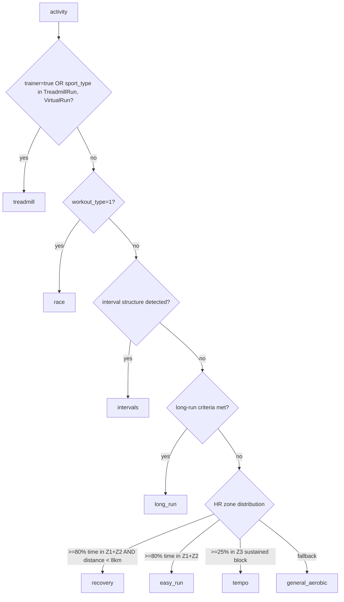

# Strava MCP Tools Catalog

This document specifies the full set of MCP tools the server should expose to Claude for run-coaching analysis.

## Scope and Constraints

- **Athlete focus:** runner. Tools assume `sport_type` in `Run`, `TrailRun`, `TreadmillRun`, `VirtualRun` unless stated.
- **Data sources:** locally ingested Postgres tables only — `strava_activities`, `strava_activity_laps`, `strava_activity_splits`, `strava_activity_best_efforts`, `strava_activity_segment_efforts`, `strava_activity_zones`, plus a cache of athlete profile and HR zones.
- **Excluded:** raw streams (deferred ingestion), power/watts, FTP, kilojoules, lat/lng/maps, cycling-specific tools, any write/mutation tools.
- **Unit conversion** applied at the tool layer (Strava is SI):
  - Distance: metres → km (3 dp).
  - Speed (m/s) → pace (`min:sec/km`) and km/h.
  - Time (s) → `Hh Mm Ss` or `M:SS` for paces.
  - Cadence (per-leg) → steps/min (× 2).
  - Elevation: m. Temp: °C. Grade: %.
- **HR zone source of truth:** `strava_athlete.heart_rate.zones`. Every HR-zone tool echoes the boundary set used in its response.
- **Context discipline:** tools return compact text + small structured tables. Row caps and bucketing are stated per tool. Granular vs aggregated siblings are clearly labelled so Claude picks the right one.

## Naming Convention

`get_*` for retrieval, `analyze_*` for derived analysis, `compare_*` for two-thing comparisons, `find_*` for filtered lookups, `track_*` for time-series progression, `detect_*` for flag detection, `classify_*` for categorisation, `compute_*` for numeric derivations, `validate_*` for diagnostics.

## Tool Entry Template

Each tool below documents:

- **Purpose** — one-line intent.
- **Inputs** — parameters with types and defaults.
- **Source** — tables and key columns read.
- **Logic** — full derivation, including formulas and thresholds.
- **Output** — fields and units; size discipline.
- **Caveats** — what to disclose to Claude when data is partial.

---

## Category A — Athlete & Configuration

### A1. `get_athlete_profile`

- **Purpose:** Return basic athlete context Claude needs for personalised analysis.
- **Inputs:** none.
- **Source:** `strava_athlete` cache (from `GET /athlete`).
- **Logic:** Strip cycling-specific fields. Compute shoe `converted_distance` summary. Skip clubs, follower counts, profile images.
- **Output:**
  - `name`, `sex`, `weight_kg`, `city`, `country`, `created_at`.
  - `shoes`: list of `{nickname, distance_km, retired}` sorted by distance desc.
- **Caveats:** Note when `weight_kg` is stale (Strava field may be months old).

### A2. `get_heart_rate_zones`

- **Purpose:** Return current HR zone definitions used for all zone-based analysis.
- **Inputs:** none.
- **Source:** `strava_athlete.heart_rate.zones` cache (from `GET /athlete/zones`).
- **Logic:** Map Strava's 5 zones into a labelled object. Strava returns `max=-1` for the open-ended top zone — translate to `null` (= no upper bound).
- **Output:**
  ```text
  Z1 (recovery): < 127 bpm
  Z2 (endurance): 127-158 bpm
  Z3 (tempo): 158-174 bpm
  Z4 (threshold): 174-189 bpm
  Z5 (VO2max): >= 189 bpm
  custom_zones: false
  ```
- **Caveats:** If `custom_zones=false`, Strava is using a max-HR-derived default; flag this so Claude knows zones may not reflect lactate-tested values.

---

## Category B — Activity Discovery

### B1. `search_activities`

- **Purpose:** Filter activities by common criteria; returns compact rows for Claude to triage.
- **Inputs:**
  - `start_date`, `end_date` (ISO date, optional).
  - `sport_type` (string or list, default all run-types).
  - `min_distance_km`, `max_distance_km` (optional).
  - `min_duration_min`, `max_duration_min` (optional).
  - `workout_type` (Strava code: 0 default, 1 race, 2 long, 3 workout).
  - `gear_id` (optional).
  - `has_heartrate`, `has_laps` (bool flags, optional).
  - `trainer` (bool, optional).
  - `limit` (default 25, max 100).
- **Source:** `strava_activities` scalar columns + `strava_activity_laps` count for `has_laps`.
- **Logic:** Single SQL query against scalar columns. Order by `start_date_local DESC`. Exclude `deleted_at IS NOT NULL`.
- **Output:** Per row: `activity_id, date, name, sport_type, distance_km, duration, avg_pace, avg_hr, elev_gain_m, lap_count`.
- **Caveats:** Result is capped at `limit`; report total matching count separately so Claude knows when to refine the filter.

### B2. `list_recent_runs`

- **Purpose:** Convenience: most recent N runs.
- **Inputs:** `n` (default 10, max 50).
- **Source:** `strava_activities` where `sport_type LIKE '%Run%'` and not deleted.
- **Logic:** Order by `start_date_local DESC`, limit `n`.
- **Output:** Same row shape as B1.
- **Caveats:** None.

### B3. `find_activity_by_date`

- **Purpose:** Resolve a date (or "today"/"yesterday") to activity IDs.
- **Inputs:** `date` (ISO date, required), `sport_type` (optional filter).
- **Source:** `strava_activities` filtered on `DATE(start_date_local) = :date`.
- **Logic:** Date comparison uses `start_date_local` (athlete's local timezone, already stored as TZ-aware). Returns 0..N matches.
- **Output:** Compact list `{activity_id, name, sport_type, distance_km, duration, start_time_local}`.
- **Caveats:** Multi-activity days return all rows; Claude must pick.

### B4. `find_similar_runs`

- **Purpose:** Find historical runs comparable to a reference run (for "how did this compare to similar runs?").
- **Inputs:**
  - `reference_activity_id` (required).
  - `lookback_days` (default 90, max 365).
  - `distance_tolerance_pct` (default 15).
  - `elev_tolerance_pct` (default 25).
  - `elev_tolerance_abs_m` (default 50; use whichever is more permissive).
  - `limit` (default 10).
- **Source:** `strava_activities` scalar columns.
- **Logic:**
  1. Load reference: `distance, total_elevation_gain, sport_type, trainer, start_date_local`.
  2. Filter candidates within `lookback_days`, same `sport_type`, same `trainer` flag, exclude reference.
  3. Apply distance tolerance: `abs(candidate.distance - ref.distance) / ref.distance <= distance_tolerance_pct/100`.
  4. Apply elev tolerance: `abs(candidate.elev - ref.elev) <= max(elev_tolerance_abs_m, ref.elev * elev_tolerance_pct/100)`.
  5. Score: `similarity_score = abs(distance_delta_pct) + 0.5 * abs(elev_delta_pct)`. Lower = more similar.
  6. Order by `similarity_score ASC`, then `start_date_local DESC`.
- **Output:** Per row: `activity_id, date, distance_km, elev_gain_m, duration, avg_pace, avg_hr, classified_type` (calls `classify_workout_type` per row).
- **Caveats:** Treadmill runs only match other treadmill runs. Distance is the dominant filter; elevation is secondary because flat-vs-flat is more comparable than hilly-vs-hilly across different routes.

---

## Category C — Single Activity Detail

### C1. `get_activity_summary`

- **Purpose:** Compact one-page summary; the default first call when Claude inspects an activity.
- **Inputs:** `activity_id`.
- **Source:** `strava_activities` scalar columns + counts from child tables.
- **Logic:** Pure read. Compute derived: `avg_pace = 1000 / average_speed / 60` → `min:sec/km`. Convert cadence × 2 → spm.
- **Output:**
  - Header: `id, name, date_local, sport_type, workout_type_label`.
  - Metrics: `distance_km, duration, elapsed_time, avg_pace, avg_hr, max_hr, avg_cadence_spm, elev_gain_m, calories, suffer_score`.
  - Flags: `trainer, manual, has_heartrate, has_laps, has_zones, has_segments, has_splits, has_best_efforts`.
  - Gear: `shoe_name, shoe_total_km`.
- **Caveats:** Disclose any `has_*` flags that are false so Claude knows what subsequent tools will fail to enrich.

### C2. `get_activity_full_details`

- **Purpose:** Maximal detail when shallow summary is insufficient.
- **Inputs:** `activity_id`.
- **Source:** `strava_activities` scalar + selected `summary_data` JSONB fields.
- **Logic:** Includes everything in C1 plus: `description, average_temp, perceived_exertion, device_name, start_time_local, timezone, achievement_count, pr_count, kudos_count, similar_activities.trend.direction, available_zones`.
- **Output:** Bounded text (no raw JSON dump).
- **Caveats:** Long descriptions are truncated to 500 chars; flag truncation.

### C3. `classify_workout_type`

- **Purpose:** Heuristic classification: `easy_run | recovery | long_run | tempo | intervals | race | treadmill | general_aerobic`.
- **Inputs:** `activity_id`.
- **Source:** `strava_activities`, `strava_activity_laps`, `strava_activity_zones` (HR distribution), athlete HR zones.

#### Classification flow



#### Interval detection (refined for autolap)

The big risk: Garmin autolap fires every 1 km on long/easy runs, producing many laps that look superficially like intervals. We must distinguish autolap from true workout laps.

Run all checks; require **all three** to be true to call it intervals:

1. **Lap distance variability.** Compute CV% of `laps[*].distance`.
   - Autolap: CV typically < 3% (every lap = 1.000 km).
   - True intervals: CV > 15% (mix of e.g. 1000 m work + 460 m rest + 1.6 km warmup).
   - Threshold: require `lap_distance_cv >= 10%`.
2. **Pace bimodality.** Run k-means (k=2) on `laps[*].average_speed`.
   - Compute centroid separation: `(fast_centroid - slow_centroid) / slow_centroid`.
   - Threshold: require `>= 0.20` (fast cluster ≥20% faster than slow cluster).
   - Autolap on a steady run produces tightly grouped speeds with separation typically < 8%.
3. **Alternation.** After clustering, verify lap labels alternate fast/slow at least 3 transitions in a row somewhere in the activity.
   - Use `pace_zone` field as an additional confirming signal: true interval reps usually land in `pace_zone` 4-6, recoveries in 1-2.

If any check fails → not classified as intervals. The activity falls through to long-run / zone-based classification.

#### Long-run criteria

- `distance >= 15 km` AND `distance >= 0.6 * max(distance)` over trailing 8 weeks of runs, AND not classified as intervals.
- Also accept: Strava's `workout_type = 2` (user-tagged long run).

#### Zone-based fallback (uses `strava_activity_zones`)

- Sum HR-zone bucket times. Map Strava buckets to the athlete's named zones.
- `easy`: ≥80% of HR-recorded time in Z1+Z2.
- `recovery`: same as easy AND `distance < 8 km` AND `avg_pace` slower than the runner's typical Z2 pace (computed from a trailing 30-day Z2 pace median).
- `tempo`: ≥25% of time in Z3, with at least one contiguous tempo block (proxy: at least one km-split in `pace_zone` 3-4 lasting ≥3 km).
- `general_aerobic`: catch-all.

#### Output

```text
type: intervals
confidence: high
signals_used:
  - lap_distance_cv: 38.4%
  - pace_cluster_separation: 51%
  - alternations_detected: 6
notes: Detected 6 work laps + 6 rest laps + warmup + cooldown.
```

#### Caveats

- If `has_heartrate=false` and `has_laps=false`, return `unknown` with confidence `low`.
- If only one signal disqualifies intervals (e.g. perfect autolap CV but high pace bimodality from a fartlek-style run), surface that as `confidence: medium` and let Claude reason further.

---

## Category D — Laps & Interval Analysis

### D1. `get_activity_laps`

- **Purpose:** Raw lap table for the activity.
- **Inputs:** `activity_id`.
- **Source:** `strava_activity_laps` ordered by `lap_index`.
- **Logic:** Pure read with unit conversion. Compute per-lap pace from `average_speed`.
- **Output:** Per row: `lap_index, name, distance_km, moving_time, pace, avg_hr, max_hr, avg_cadence_spm, total_elevation_gain_m, pace_zone`.
- **Caveats:** Some devices emit a final tiny lap (e.g. 0.04 km) when the runner stops mid-lap; flag laps with `distance < 50 m` as auto-end fragments.

### D2. `analyze_intervals`

- **Purpose:** Structural analysis of an interval workout: detect work/rest/warmup/cooldown, compute consistency, recovery, fade.
- **Inputs:** `activity_id`.
- **Source:** `strava_activity_laps` ordered by `lap_index`, plus athlete HR zones.

#### Step 1 — Confirm interval structure

Run `classify_workout_type`'s interval detection (D2 should not run on non-interval activities). If the classifier did not return `intervals`, this tool returns:

```text
No interval structure detected. Use analyze_pacing for steady-state runs.
```

#### Step 2 — Identify warmup and cooldown

Examine laps from each end inward:

- **Warmup candidate** = leading contiguous laps where ALL hold:
  - `pace_zone <= 2`, AND
  - `avg_hr < zone3_lower_bound` (athlete's Z3 floor), AND
  - lap is *before* the first lap that lands in the "fast" cluster from k-means.
- **Cooldown candidate** = trailing contiguous laps with the same criteria *after* the last fast-cluster lap.
- A warmup/cooldown block is typically 1-2 laps but may be longer (your long-warmup intervals example shows a 1.6 km warmup as Lap 1 and a 4.8 km cooldown as Lap 14).

If a leading/trailing lap has `distance` substantially larger than the median work-lap distance (e.g. > 1.5×) AND HR/pace criteria above, prefer to label it warmup/cooldown rather than work.

#### Step 3 — Cluster remaining laps into work vs rest

- Apply k-means (k=2) on `average_speed` for the laps not assigned to warmup/cooldown.
- "Fast cluster" = work; "slow cluster" = rest.
- Sanity gate: if cluster centroid separation drops below 15% after warmup/cooldown removal, return: `Could not cleanly separate work from rest after warmup/cooldown removal — possibly fartlek or unstructured.`
- Confirming signal: `pace_zone` of work laps should usually be 4-6; of rest laps, 1-2.

#### Step 4 — Validate alternation

Walk the work/rest sequence after warmup/cooldown. Expected pattern is `W R W R W R ...`. If the pattern instead shows `W W W R W` or similar, label the workout as `non-standard structure` and emit a warning, but still compute per-rep stats.

#### Step 5 — Per-rep metrics

For each work lap, output:

```text
rep_index, distance_m, time, pace_min_per_km, avg_hr, max_hr, avg_cadence_spm, total_elev_gain_m
```

#### Step 6 — Consistency (CV%)

Compute coefficient of variation over the work-rep set:

- `pace_cv_pct = stdev(pace_seconds_per_km) / mean(pace_seconds_per_km) * 100`
- `hr_cv_pct = stdev(work_lap.average_heartrate) / mean(...) * 100`
- `distance_cv_pct = stdev(work_lap.distance) / mean(...) * 100`
- `cadence_cv_pct = stdev(work_lap.average_cadence) / mean(...) * 100`

Coach interpretation thresholds:

- Pace CV: `< 2%` excellent, `2-4%` solid, `4-7%` drifting, `> 7%` inconsistent.
- HR CV: `< 2%` very even effort, `2-5%` normal, `> 5%` likely drifting.
- Distance CV (when reps are intended to be equal length, e.g. 6×1k): `< 1%` confirms uniform reps, `> 5%` suggests user manually lapped or did mixed reps.

#### Step 7 — Recovery HR drop

For each rest lap immediately following a work lap:

- `recovery_drop_bpm = work_lap.max_heartrate - rest_lap.average_heartrate`
- Alternate (cleaner): `work_lap.average_heartrate - rest_lap.average_heartrate`
- Report both. Output per pair, plus aggregate avg/min/max.

Coach thresholds:

- `> 25 bpm` strong cardiac recovery.
- `15-25 bpm` typical.
- `10-15 bpm` modest — possibly running rest too hard or fatigued.
- `< 10 bpm` poor recovery — accumulated fatigue or rest too short/too fast.

#### Step 8 — Fade across reps

For each metric (`pace_seconds_per_km`, `average_heartrate`, `average_cadence`):

- **First-vs-last delta:** simple `last - first`.
- **Linear regression slope:** `slope = cov(rep_index, metric) / var(rep_index)`. Reported as `unit per rep`.
  - Use the slope when there are ≥6 reps; for 3-5 reps, use first-vs-last delta only.

Coach interpretation:

- Pace slope positive AND HR slope positive → aerobic decoupling under interval stress (overcooked early or under-recovered).
- Pace slope negative AND HR slope flat or negative → strong negative split, sandbagged early.
- Pace flat AND HR slope positive → cardiac drift; effort is creeping up to hold pace (typical late-workout fatigue).
- Cadence slope negative → form breaking down.

#### Step 9 — Work:rest ratio

- `work_rest_ratio = mean(work_lap.moving_time) / mean(rest_lap.moving_time)`
- Reported as `1:X` style (e.g. `1:0.70` means rest is 70% of work duration).

#### Output (compact)

```text
Workout: 6 x 1km @ work, 460m rest, plus 1.6km warmup + 4.8km cooldown
Detected via: lap-distance CV 38%, pace cluster separation 51%, 6 alternations.

Work reps:
  1) 1.00km  4:18/km  HR avg 173 max 181  cad 173 spm
  2) 1.00km  4:20/km  HR avg 174 max 181  cad 173 spm
  3) 1.00km  4:17/km  HR avg 176 max 182  cad 173 spm
  4) 1.00km  4:19/km  HR avg 174 max 179  cad 172 spm
  5) 1.00km  4:16/km  HR avg 175 max 180  cad 173 spm
  6) 1.00km  3:58/km  HR avg 176 max 180  cad 173 spm

Consistency: pace CV 2.1% (excellent), HR CV 0.7% (very even)
Recovery HR drop (work_max -> rest_avg): avg 18 bpm (range 14-22) — typical
Fade across reps:
  pace slope: -4.0 sec/km per rep (negative split, finishing strong)
  HR slope:   +0.6 bpm per rep (minimal drift)
  cad slope:  -0.1 spm per rep (form held)
Work:rest ratio = 1:0.70

Zones used: Z1 < 127, Z2 127-158, Z3 158-174, Z4 174-189, Z5 >= 189 bpm.
```

#### Caveats

- HR or cadence missing on a rep → that rep contributes to the rep table but is excluded from CV / slope calcs; flag count of excluded reps.
- "Non-standard structure" warnings are passed through.
- If detection downgraded to `low confidence`, tell Claude to also call `analyze_pacing` for a second view.

### D3. `compare_laps_within_activity`

- **Purpose:** Side-by-side lap deltas across the whole activity (not work/rest separated).
- **Inputs:** `activity_id`.
- **Source:** `strava_activity_laps`.
- **Logic:** For each lap N>1, compute deltas vs lap N-1: pace delta (sec/km), HR delta (bpm), cadence delta (spm), elev delta (m).
- **Output:** Table per lap with absolute and delta values.
- **Caveats:** Less useful for true intervals (use D2 instead); most useful for tempo/long runs to show progression.

### D4. `get_warmup_cooldown_quality`

- **Purpose:** Assess whether warmup got the runner ready and cooldown brought them down.
- **Inputs:** `activity_id`.
- **Source:** `strava_activity_laps`, athlete HR zones.
- **Logic:**
  - Identify warmup/cooldown laps using D2's Step 2 logic.
  - Warmup quality criteria:
    - `avg_hr < zone3_lower_bound` for warmup laps → flag if violated.
    - Pace within `Z1-Z2` pace bands (use trailing 30-day pace median for Z2).
    - Duration ≥ 8 minutes ideally for an interval session.
  - Cooldown quality criteria:
    - End-of-cooldown HR < `zone2_upper_bound` (proxy: HR of last lap's last sample is unavailable without streams; use `cooldown_lap.average_heartrate < zone2_upper`).
    - Duration ≥ 5 minutes.
- **Output:**
  ```text
  Warmup: 1.6km in 10:07, avg HR 143 (Z2) — adequate
  Cooldown: 4.8km in 27:51, avg HR 152 (Z2) — adequate, but HR didn't drop into Z1
  ```
- **Caveats:** Without streams, end-of-cooldown HR is approximated by last-lap average — disclose this.

---

## Category E — Splits & Pacing

### E1. `get_activity_splits`

- **Purpose:** Per-km (metric) or per-mile (standard) splits.
- **Inputs:** `activity_id`, `unit` (`metric`|`standard`, default `metric`).
- **Source:** `strava_activity_splits` filtered by source.
- **Logic:** Pure read; convert speed → pace; expose `average_grade_adjusted_speed` as `gap_pace`.
- **Output:** Per row: `split, distance_km, time, pace, gap_pace, avg_hr, elev_difference_m, pace_zone`.
- **Caveats:** Final partial split (e.g. 0.24 km) is included but flagged as fractional.

### E2. `analyze_pacing`

- **Purpose:** Pacing structure of a steady run (tempo, easy, long).
- **Inputs:** `activity_id`, `unit` (default `metric`).
- **Source:** `strava_activity_splits`.
- **Logic:**
  - **Halves comparison:**
    - Split the kms into first half and second half by total distance.
    - `first_half_avg_pace`, `second_half_avg_pace`.
    - `split_type`: `negative_split` if 2nd half ≥ 5 sec/km faster, `positive_split` if ≥ 5 sec/km slower, else `even`.
  - **Variability:** `pace_cv_pct = stdev(split.pace_sec_per_km) / mean(...) * 100`.
  - **Range:** fastest km, slowest km.
  - **Fade slope:** linear regression of `pace_sec_per_km` vs `split_index`. Positive slope = fading.
  - Filter out final fractional split (< 0.7 km) before stats.
- **Output:**
  ```text
  Pacing: positive split (+18 sec/km in 2nd half)
  Pace CV: 6.2% (variable)
  Fastest km: km 4 @ 4:24/km
  Slowest km: km 11 @ 6:15/km
  Fade slope: +5.4 sec/km per km
  ```
- **Caveats:** Inappropriate for interval workouts; the variation is structural, not pacing failure. Tool should detect interval classification first and short-circuit with: "This was an interval workout — call analyze_intervals."

### E3. `analyze_grade_adjusted_pace`

- **Purpose:** Separate effort from terrain by comparing actual pace vs grade-adjusted pace.
- **Inputs:** `activity_id`.
- **Source:** `strava_activity_splits` (`average_speed` and `average_grade_adjusted_speed`).
- **Logic:**
  - Per split: `pace = 1000/avg_speed/60`; `gap = 1000/gap_speed/60`; `gap_delta = pace - gap` (positive means terrain made you slower than your effort).
  - Aggregate: `mean(gap_delta)`, `max(gap_delta)`, identify the hilliest km.
  - `effort_consistency_cv = stdev(gap_pace_sec_per_km) / mean(gap_pace_sec_per_km) * 100` — this is a better effort-consistency metric than raw pace CV when terrain varies.
- **Output:** Per-split table + aggregate; commentary on whether perceived hilliness explained the slowdown.
- **Caveats:** GAP is Strava's model, not a physiological measure; flag as approximate.

---

## Category F — Heart Rate & Zones

### F1. `get_activity_hr_zone_distribution`

- **Purpose:** Time-in-zone for one activity.
- **Inputs:** `activity_id`.
- **Source:** `strava_activity_zones` (the heartrate-type entry's `distribution_buckets`), athlete HR zones.
- **Logic:**
  - Strava returns 5 buckets matching the athlete's zone definitions; pull `time` (seconds) per bucket.
  - Compute totals: `total_zoned_time = sum(times)`, `pct = bucket.time / total * 100`.
  - Echo athlete zone boundaries used.
- **Output:**
  ```text
  Zones used: Z1 < 127, Z2 127-158, Z3 158-174, Z4 174-189, Z5 >= 189 bpm.
  Z1: 00:43  ( 0.9%)
  Z2: 48:19  (60.5%)
  Z3: 12:41  (15.9%)
  Z4: 19:39  (24.6%)
  Z5: 00:00  ( 0.0%)
  Total HR-recorded time: 81:22
  ```
- **Caveats:** If the activity has no zones row, return: "Zone data not ingested for this activity (Strava-Summit-only)" and offer a derived alternative (F2 manual calc requires streams, so cannot offer here).

### F2. `analyze_hr_decoupling`

- **Purpose:** Detect aerobic decoupling without raw streams: rising HR at the same pace.
- **Inputs:** `activity_id`.
- **Source:** `strava_activity_splits` (km splits with `average_speed` and `average_heartrate`).
- **Logic:**
  - Filter to the steady-state body of the run: drop first 2 km (warmup) and last 1 km (final-km surge or fatigue spike). Configurable.
  - Within the remaining kms, group by pace bucket: bucket = `floor(pace_sec_per_km / 10)` (10-sec bins).
  - For each bucket with ≥2 splits, compute `mean_hr` per first-half-of-run kms vs second-half-of-run kms.
  - **Decoupling metric:** `decoupling_pct = (second_half_mean_hr - first_half_mean_hr) / first_half_mean_hr * 100`, computed per pace bucket and weighted by km count, then averaged.
  - Coach thresholds (Friel-style adapted):
    - `< 5%` strong aerobic fitness (efficient).
    - `5-10%` acceptable.
    - `> 10%` poor aerobic durability or under-fuelled / hot day.
- **Output:**
  ```text
  Steady-state body: km 3-14
  Pace bucket 5:30-5:40/km: 1st-half HR 152, 2nd-half HR 159 (decoupling +4.6%)
  Pace bucket 5:40-5:50/km: 1st-half HR 149, 2nd-half HR 156 (decoupling +4.7%)
  Weighted average decoupling: +4.6%  (good aerobic durability)
  ```
- **Caveats:** Splits-based decoupling is coarser than streams-based Pa:HR; flag as approximate. Requires ≥6 km of steady running to be meaningful.

### F3. `get_period_hr_zone_distribution`

- **Purpose:** Aggregated time-in-zone across multiple activities in a date range.
- **Inputs:** `start_date`, `end_date`, `sport_type` (default run-types).
- **Source:** `strava_activity_zones` joined to `strava_activities`.
- **Logic:**
  - Sum bucket times across all matched activities' heartrate zone rows.
  - Compute totals and percentages.
  - Also compute per-activity Z3+Z4+Z5 minutes as a `quality_minutes` rollup.
- **Output:**
  ```text
  Period: 2026-04-01 to 2026-04-30 (12 runs with HR zones)
  Z1: 00:31  ( 0.4%)
  Z2: 06:42:18  (76.2%)
  Z3: 01:09:11  (13.1%)
  Z4: 00:51:14  ( 9.7%)
  Z5: 00:04:09  ( 0.6%)
  Quality minutes (Z3+Z4+Z5): 124.6 min
  Easy minutes (Z1+Z2): 402.8 min
  Easy/quality ratio: 3.2 : 1
  ```
- **Caveats:** Activities missing zones are excluded from the sum but reported as a count. Skewed totals when only some runs have HR.

### F4. `validate_hr_zones`

- **Purpose:** Diagnostic — are the configured HR zones actually well-calibrated for this athlete given recent data?
- **Inputs:** `lookback_days` (default 60).
- **Source:** `strava_activities` (max_heartrate per run), `strava_activity_zones` (HR distribution per run), athlete HR zones.
- **Logic:**
  - **Max HR check:** find `max(activities.max_heartrate)` over the period. Compare to current Z5 lower bound. Flags:
    - If observed max > current Z5 lower bound + 5: zones may be set too low — Z5 is being entered "too easily".
    - If observed max < current Z5 lower bound - 10: Z5 is never reached, zones may be set too high (or athlete hasn't done a max effort recently).
  - **Easy run distribution check:** for runs classified `easy_run` or `recovery`, what % of HR time is in Z1+Z2?
    - Healthy: ≥85%.
    - If recurring easy runs land 30%+ in Z3, Z2 ceiling may be too low (or athlete chronically runs easy too hard).
  - **Polarization check:** compute period-wide `Z1+Z2 : Z4+Z5` time ratio. Coach reference (80/20 polarized): expect roughly 4:1 to 5:1.
    - `< 3:1` → too much moderate (grey zone) work.
    - `> 8:1` → very low intensity overall.
- **Output:** Bullet diagnostics with concrete suggestions ("observed max HR was 192 over 60 days but Z5 starts at 189 — zones look correct", "easy runs averaging 22% in Z3 — consider Z2 ceiling or run-easy discipline").
- **Caveats:** Diagnostic only; never auto-edits zones.

---

## Category G — Cadence

### G1. `analyze_cadence`

- **Purpose:** Cadence per lap, drift, and comparison to the runner's baseline.
- **Inputs:** `activity_id`.
- **Source:** `strava_activity_laps`, `strava_activities` (the activity's `average_cadence`), and trailing-30-day median for baseline.
- **Logic:**
  - Convert `lap.average_cadence × 2` → spm.
  - Per lap: cadence value + delta from activity average.
  - Drift: linear regression slope of cadence over `lap_index` (spm per lap).
  - Baseline: `baseline_cadence = median(activities.average_cadence × 2)` over trailing 30 days of runs.
  - Flag: activity_avg_cadence < baseline - 3 spm → "lower than your baseline" (potential fatigue or slow run).
- **Output:** Lap table + summary with baseline comparison.
- **Caveats:** Treadmill / very slow recovery runs naturally have lower cadence; don't alarm.

### G2. `get_cadence_trend`

- **Purpose:** Per-run average cadence over time.
- **Inputs:** `start_date`, `end_date` (or `lookback_days`).
- **Source:** `strava_activities`.
- **Logic:** Per run: date, distance, avg_pace, avg_cadence_spm. Compute period mean and slope (spm per week) via linear regression on `start_date_local`.
- **Output:** Compact table (capped at 50 rows) + trend slope.
- **Caveats:** Cadence varies with pace; if distances differ wildly across the period, note that as a confound.

---

## Category H — Elevation & Terrain

### H1. `get_elevation_profile_summary`

- **Purpose:** Terrain context without map data.
- **Inputs:** `activity_id`.
- **Source:** `strava_activities` scalar fields (`total_elevation_gain`, `elev_high`, `elev_low`) + `strava_activity_splits` (per-km `elevation_difference`).
- **Logic:**
  - Total gain (m), high/low (m), `gain_per_km = total_elevation_gain / distance_km`.
  - **Hilliness index:** `sum(abs(split.elevation_difference)) / distance_km` — captures both up and down (a flat run has near 0; a rolling run has a meaningful value even if net = 0).
  - Identify hilliest km: `max(abs(split.elevation_difference))`.
- **Output:**
  ```text
  Total gain: 73 m, gain per km: 4.8 m/km
  Elev range: 6.2 m to 35.4 m
  Hilliness index: 9.1 m/km (rolling)
  Hilliest km: km 11 (+13.6 m)
  ```
- **Caveats:** Treadmill/indoor activities have null elevation; return short message.

---

## Category I — Best Efforts & PRs

### I1. `get_activity_best_efforts`

- **Purpose:** Standard distance benchmarks set within a single activity.
- **Inputs:** `activity_id`.
- **Source:** `strava_activity_best_efforts`.
- **Logic:** List Strava-emitted efforts (400m, 1/2 mile, 1k, 1 mile, 2 mile, 5k, 10k, 15k, half, marathon as available). Convert to pace.
- **Output:** Per row: `name, distance_m, time, pace, pr_rank` (1=PR, 2=2nd best, 3=3rd, null=neither).
- **Caveats:** Best efforts are auto-detected by Strava; not all distances appear on every run.

### I2. `track_best_effort_progression`

- **Purpose:** Trend of a benchmark distance over time.
- **Inputs:** `effort_name` (e.g. `"5K"`), `lookback_days` (default 365), `limit` (default 50).
- **Source:** `strava_activity_best_efforts` joined to `strava_activities`.
- **Logic:**
  - Filter by `name = effort_name`.
  - Order by `start_date_local DESC`, limit `limit`.
  - Track `elapsed_time` over time; compute month-over-month best (min time per calendar month).
  - Identify all-time best in the window.
  - Linear regression of `elapsed_time` vs days-since-start → seconds per month trend.
- **Output:** Compact table (date, time, pace) + summary (best in period, monthly bests, trend).
- **Caveats:** Best efforts found in workout reps (not all-out efforts) skew the picture; flag if best appeared during an interval workout vs a race.

### I3. `find_pr_activities`

- **Purpose:** Activities that set Strava-tracked PRs.
- **Inputs:** `lookback_days` (default 365).
- **Source:** `strava_activities` where `pr_count > 0`, joined to `strava_activity_best_efforts` filtered to `pr_rank = 1`.
- **Logic:** Order by `start_date_local DESC`. For each activity list PR efforts with their times.
- **Output:** Activity row + PR list per row.
- **Caveats:** Strava PR scope is per-distance benchmarks within run-type activities only.

---

## Category J — Aggregations

### J1. `get_weekly_summary`

- **Purpose:** Per-week training rollup.
- **Inputs:** `weeks` (default 4, max 26), `week_start` (`monday`|`sunday`, default `monday`).
- **Source:** `strava_activities`, `strava_activity_zones`.
- **Logic:** For each ISO-week:
  - `total_distance_km = sum(distance) / 1000`
  - `total_moving_time = sum(moving_time)`
  - `run_count = count(*)`
  - `longest_run_km = max(distance) / 1000`
  - `total_elev_gain_m = sum(total_elevation_gain)`
  - `avg_hr_weighted = sum(avg_hr * moving_time) / sum(moving_time)` (time-weighted)
  - `interval_count = count of activities classified as intervals` (uses C3 cached classification or computes lazily)
  - `quality_minutes = sum(Z3 + Z4 + Z5 time)` (from F3 logic per activity)
  - `easy_pct = Z1+Z2 time / total HR-recorded time`
- **Output:** Compact table per week with the above columns.
- **Caveats:** Activities missing HR are summed for distance/time but excluded from HR/zone aggregates.

### J2. `get_monthly_summary`

- **Purpose:** Per-calendar-month rollup.
- **Inputs:** `months` (default 6, max 24).
- **Source:** Same as J1.
- **Logic:** Same metric set as J1 but bucketed by calendar month (using `start_date_local`).
- **Output:** Same shape as J1.
- **Caveats:** Same as J1.

### J3. `get_period_summary`

- **Purpose:** Custom date-range rollup (single result, not bucketed).
- **Inputs:** `start_date`, `end_date`, `sport_type` (default run-types).
- **Source:** Same as J1.
- **Logic:** All J1 metrics computed once over the full range. Adds: count by classified workout type (easy / long / interval / tempo / race / recovery / treadmill / general).
- **Output:** Single block of metrics.
- **Caveats:** Same as J1.

---

## Category K — Trends & Progression

### K1. `get_volume_trend`

- **Purpose:** Weekly mileage trend with rolling averages.
- **Inputs:** `weeks` (default 12, max 52).
- **Source:** `strava_activities`.
- **Logic:**
  - Per week: `weekly_km = sum(distance) / 1000`.
  - `rolling_7d_km` and `rolling_28d_km`: computed at week-end dates from the trailing 7 / 28 days.
  - `wow_change_pct = (this_week - last_week) / last_week * 100`.
  - Flag: `abs(wow_change_pct) > 25` (sharp ramp or drop) or `(this_week / 4wk_avg) > 1.4` (weekly volume ramp >40% above recent baseline — injury risk).
- **Output:** Per-week table + flags.
- **Caveats:** Doesn't account for cross-training (only running activities here).

### K2. `get_intensity_distribution`

- **Purpose:** Polarized vs pyramid vs threshold mix over a period.
- **Inputs:** `start_date`, `end_date`.
- **Source:** `strava_activity_zones` joined to `strava_activities`.
- **Logic:**
  - Sum zone times across all activities in period.
  - Compute pcts.
  - Classify shape:
    - **Polarized**: Z1+Z2 ≥ 75% AND Z4+Z5 ≥ 15% AND Z3 ≤ 10%.
    - **Pyramid**: Z1+Z2 > Z3 > Z4+Z5, gradual taper.
    - **Threshold-heavy**: Z3 ≥ 25%.
    - **Low-intensity**: Z4+Z5 < 5%.
  - Compare to a polarized 80/20 ideal.
- **Output:** Pcts + classification + commentary.
- **Caveats:** Reliable only with sufficient HR-zoned activities (warn if < 6 in period).

### K3. `get_long_run_progression`

- **Purpose:** Longest run per week trend.
- **Inputs:** `weeks` (default 12).
- **Source:** `strava_activities`.
- **Logic:** Per ISO-week: `max(distance)`. Compute slope (km per week) and identify the trend direction.
- **Output:** Per-week table + slope.
- **Caveats:** A missing-data week (vacation, injury) shows 0 — flag weeks with `run_count = 0`.

### K4. `get_pace_at_distance_progression`

- **Purpose:** Pace trend within a distance band (e.g. how is your 8-12 km pace evolving?).
- **Inputs:** `min_distance_km`, `max_distance_km`, `lookback_days` (default 180).
- **Source:** `strava_activities`.
- **Logic:**
  - Filter to runs in the distance band.
  - Optionally exclude intervals (use C3 classification) so we measure steady-state pace.
  - Per run: date, distance, pace, avg_hr.
  - Compute monthly median pace; linear regression of pace vs date (sec/km per month).
- **Output:** Per-month median pace + trend slope.
- **Caveats:** Conflates all terrain and conditions; consider pairing with H1 / E3 results for context.

---

## Category L — Comparisons

### L1. `compare_activities`

- **Purpose:** Two-activity side-by-side.
- **Inputs:** `activity_id_a`, `activity_id_b`.
- **Source:** `strava_activities`, `strava_activity_zones`.
- **Logic:** Pull C1-style summary for each; compute deltas: distance, duration, pace (sec/km), avg_hr, avg_cadence, elev_gain, suffer_score, time-in-zone (Z1..Z5 deltas in minutes).
- **Output:** Two columns + delta column.
- **Caveats:** If sport_type / distance / terrain are very different, note that the comparison is suggestive only.

### L2. `compare_periods`

- **Purpose:** Two date ranges (e.g. last 4 weeks vs prior 4 weeks).
- **Inputs:** `period_a_start`, `period_a_end`, `period_b_start`, `period_b_end`.
- **Source:** Same as J3.
- **Logic:** Run J3 for each period; compute deltas on every metric.
- **Output:** Three columns (A, B, delta).
- **Caveats:** Watch for partial-period skew when periods have different lengths.

### L3. `compare_to_similar_recent_runs`

- **Purpose:** Pit one activity against its closest historical comparables.
- **Inputs:** `activity_id`, `lookback_days` (default 90), `n_similar` (default 5).
- **Source:** `find_similar_runs` + per-activity summaries.
- **Logic:**
  - Call B4 internally to get `n_similar` comparables.
  - Compute medians across the comparable set: median pace, median avg_hr, median avg_cadence, median elev gain, median Z1+Z2 %, median Z3+Z4+Z5 %.
  - Compute per-metric delta: `reference - median_of_similar`. Flag any metric whose absolute z-score across the comparable set is > 1.5.
- **Output:** Reference metrics, comparable-set medians, deltas, flags.
- **Caveats:** `n_similar < 3` → "insufficient comparables" warning.

---

## Category M — Training Load & Recovery

### M1. `get_recovery_status`

- **Purpose:** Snapshot of how recovered the athlete is right now.
- **Inputs:** `as_of_date` (default today).
- **Source:** `strava_activities`.
- **Logic:**
  - `days_since_last_run`.
  - `days_since_last_hard_run`: hard = classified as `intervals`, `tempo`, or `race`, OR avg_hr ≥ Z3 lower bound for ≥30% of moving time.
  - `consecutive_easy_days` ending today.
  - `last_7d_distance_km`, `last_28d_distance_km / 4` (4-week weekly avg).
  - `last_7d_vs_4wk_pct = last_7d / (last_28d/4) - 1`.
- **Output:**
  ```text
  Days since last run: 1
  Days since last hard run: 4 (intervals on 2026-04-18)
  Consecutive easy days: 3
  Last 7d: 38.2 km. 4wk weekly avg: 42.6 km. Delta: -10%.
  ```
- **Caveats:** Only knows about Strava-logged work; doesn't see strength training that wasn't recorded.

### M2. `compute_acute_chronic_ratio`

- **Purpose:** Acute (7-day) vs chronic (28-day) load ratio. Injury-risk proxy.
- **Inputs:** `as_of_date` (default today), `metric` (`distance`|`duration`, default `distance`).
- **Source:** `strava_activities`.
- **Logic:**
  - `acute = sum(metric) over trailing 7 days`
  - `chronic = sum(metric) over trailing 28 days / 4`
  - `acwr = acute / chronic` (guard for chronic = 0).
- Coach thresholds (Gabbett-style):
  - `0.8 - 1.3` sweet spot.
  - `< 0.8` undertrained (ramp room available).
  - `1.3 - 1.5` caution.
  - `> 1.5` injury-risk flag.
- **Output:** `acute, chronic, acwr, classification, commentary`.
- **Caveats:** Heuristic only; not a substitute for HRV/sleep data.

### M3. `detect_training_red_flags`

- **Purpose:** Surface concerning patterns over the last N weeks.
- **Inputs:** `lookback_weeks` (default 4).
- **Source:** All training tables.
- **Logic:** Run a battery of checks; emit a flag list:
  - **Volume ramp:** any week's distance > 1.4× the trailing-4wk avg (uses K1).
  - **No long run:** longest run in the last 2 weeks < 0.6 × trailing-8wk longest-run median.
  - **No rest days:** 14+ consecutive days with a run (no 0-run days).
  - **HR drift up at same paces:** call F2 across the period; weighted decoupling > 8% on multiple runs.
  - **Pace regression:** K4 slope on a stable distance band shows pace slowing > 5 sec/km per month.
  - **Easy-run intensity creep:** F4's easy-run distribution check shows > 30% Z3+ on classified easy runs.
  - **Suffer score spike:** weekly sum of `suffer_score` > 1.5× trailing-4wk avg.
- **Output:** List of triggered flags with the underlying numbers; "all clear" when none trigger.
- **Caveats:** Each flag is a heuristic; Claude should weigh against context (e.g. a deliberate ramp before a goal race).

---

## Category N — Gear & Data Meta

### N1. `get_shoe_mileage`

- **Purpose:** Per-shoe usage and replacement risk.
- **Inputs:** `include_retired` (default false).
- **Source:** Athlete `shoes` cache + `strava_activities.gear_id`.
- **Logic:**
  - For each shoe: `total_distance_km` (from athlete cache; Strava maintains this), `last_used_date`, `runs_count` over trailing 90 days, `last_30d_km`.
  - Replacement-risk flags:
    - `total_distance_km >= 600` → "consider replacement".
    - `total_distance_km >= 800` → "replace".
- **Output:** Per shoe: `name, total_km, last_used_date, runs_last_90d, last_30d_km, flag`.
- **Caveats:** Strava distance is what it is — if user logs runs without selecting shoes, mileage is undercounted.

### N2. `check_data_availability`

- **Purpose:** Tell Claude what data exists before asking deeper questions.
- **Inputs:** Either `activity_id` OR `start_date`+`end_date`.
- **Source:** All tables, just availability flags.
- **Logic:**
  - **Per activity:** flags for `has_heartrate, has_laps (count), has_splits_metric (count), has_splits_standard (count), has_best_efforts (count), has_segments (count), has_zones`.
  - **Per range:** count of activities, count missing HR, count missing laps, count missing zones, dates with no run logged (gap detection).
- **Output:** Compact flag list; for ranges, also a list of dates with zero activities.
- **Caveats:** "No activity on date X" doesn't mean the user didn't train — could be unrecorded.

---

## Cross-Tool Conventions

### Pace formatting

- Always `M:SS/km` (e.g. `4:18/km`) when displaying pace.
- Always include km/h alongside when the user might want both, e.g. in `get_activity_summary`.
- Internally compute in seconds-per-km for math; convert at the formatting layer.

### Time formatting

- Durations < 1 hour: `MM:SS`.
- Durations ≥ 1 hour: `H:MM:SS`.
- Day counts: integer `Nd`.

### Date handling

- All date filters use `start_date_local` (athlete's local TZ stored in DB), not UTC.
- "Week" defaults to ISO week (Monday start) unless user passes `week_start=sunday`.

### Disclosure block

Tools that depend on assumptions (HR zones, classifier thresholds, decoupling cutoffs) include a `Notes:` block at the end of their output stating which thresholds were applied. This lets Claude be transparent in its answer.

### Soft-deleted activities

All queries exclude `deleted_at IS NOT NULL` unless the tool is explicitly inspecting deletion state.

### Cycling and other sports

If `sport_type` is not a run-type, run-specific tools return: "This tool is run-only; activity X is type Y." Aggregation tools accept `sport_type` parameters and quietly include only matching activities.

---

## Tool Selection Cheat Sheet (for Claude)

| User question | First tool to call |
|---|---|
| "How was my run today?" | `find_activity_by_date` → `classify_workout_type` → matching analyser (D2 / E2 / F1) |
| "Analyze my intervals" | `analyze_intervals` |
| "Analyze my long run" | `get_activity_summary` + `analyze_pacing` + `analyze_hr_decoupling` + `analyze_grade_adjusted_pace` |
| "How has my fitness progressed?" | `get_volume_trend` + `track_best_effort_progression(5K)` + `get_intensity_distribution` |
| "Am I on track with my goals?" | `compare_periods` (last 4w vs prior 4w) + `get_long_run_progression` + `compute_acute_chronic_ratio` |
| "Do my HR zones look right?" | `validate_hr_zones` |
| "Should I change anything?" | `detect_training_red_flags` + `get_recovery_status` |
| "Compare today's run to similar past runs" | `compare_to_similar_recent_runs` |
| "How are my shoes?" | `get_shoe_mileage` |
| "What data do you have?" | `check_data_availability` |
